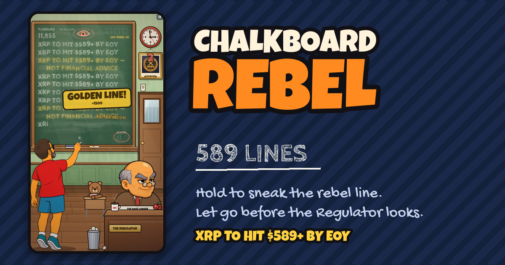

# Chalkboard Rebel: 589 Lines



You're in detention. The Regulator wants **"I WILL NOT SHILL $589"** a hundred times.
Every time he looks away, you sneak **"XRP TO HIT $589+ BY EOY"** onto the board instead.

**Hold** to write the rebel line. **Let go** before he looks up. Don't get caught.

A one-button, mobile-first browser game for the $589 community on the XRP Ledger.
Vanilla JavaScript (ES modules) and Canvas 2D. No framework and no build step. All sound is synthesized with WebAudio.

- **Play:** https://xamm4.github.io/589-chalkboard/ (once GitHub Pages is enabled, see [Deploy](#deploy))
- **Design decisions, tuning, balance results:** [DESIGN_NOTES.md](DESIGN_NOTES.md)

## Controls

| Action | Touch / mouse | Keyboard |
|---|---|---|
| Write the rebel line | press and hold anywhere | hold **Space** (or Enter) |
| Behave (write the punishment) | let go | release |
| Throw the paper airplane | tap the **THROW!** button | **A** |
| Pause | ⏸ top-right | **Esc** / **P** |

## Run locally

The game is static files. Serve the folder over HTTP. ES modules, fonts and audio do **not** work from `file://`.

```bash
npm start            # node tests/server.mjs 5890 → http://localhost:5890
# or: npx serve .    # any static server works
```

Useful URL parameters:

| Param | Effect |
|---|---|
| `?debug=1` | debug panel: state machine, timers, invincibility, jump to any day, slow-mo, spawn airplane |
| `?seed=1234` | fixed RNG seed (reproducible runs) |
| `?day=3` | start on a given day (0 = Monday … 5 = EOY, 6 = Overtime) |
| `?speed=4` | run the simulation faster (used by the e2e tests) |

## Tuning

Every gameplay number lives in **`src/config.js`**:

- `write`: letters per second for the rebel line (11), golden line (8), punishment (4), and the chalk-regrab penalty.
- `timing`: grace window (140 ms), close-call window (180 ms), caught freeze, card and bell durations.
- `score`: points per letter and per line, golden ×3, close call +250, streak multipliers `[1, 1.5, 2, 3, 5]`.
- `days[]`: per-day duration, quota, read / tell / turn / look / return timings, fake and snap chances, multi-peeks, events, and teacher mode (`desk` or `walk`).
- `overtime`: how the endless mode escalates after EOY.
- `events`: the bear, blackout, principal, fly and airplane timings.
- `audio.files`: optional mp3 overrides (see below).
- `gameUrl`: appended to the share text.

After changing timings, run `npm run balance` to see how bot players of different skill fare (see DESIGN_NOTES.md).

### Optional sound files

Everything is synthesized by default. To use real recordings, drop mp3 files into `assets/sfx/` and list them in `CONFIG.audio.files`, e.g. `{ bell: 'bell.mp3', slam: 'slam.mp3' }`. Only listed files are fetched, so a missing file never causes a 404. Sound names are the keys of `SOUNDS` in `src/audio.js`.

## Embed on 589onxrpl.com

```html
<iframe src="https://xamm4.github.io/589-chalkboard/" title="Chalkboard Rebel"
  style="width:100%;max-width:480px;height:min(900px,92vh);border:0;border-radius:16px;display:block;margin:0 auto"
  allow="autoplay; fullscreen; clipboard-write" loading="lazy"></iframe>
```

The game makes no assumptions about the parent window, makes no network calls (fonts are self-hosted), uses no `alert`, and keeps all progress in `localStorage` (`chalkboardRebel_v1`), wrapped in try/catch so it degrades to in-memory when storage is blocked.

## Tests

```bash
npm install          # only needed for the Playwright runner
npm run test:unit    # node:test: state machine, scoring, catches, close calls, quota, determinism
npm run test:e2e     # Playwright: a bot plays through the real UI at 390×844, 360×640, 1280×800 and in a 480×700 iframe
npm run balance      # 1,000 headless bot games per skill profile → which day they reach
```

The e2e test checks for console errors, that the score goes up, that a day transition happens, and that the results screen fits the viewport without scrolling.
If your Playwright version doesn't match the installed browsers, point it at a Chromium binary with `PW_CHROMIUM_PATH=/path/to/chromium`.

## Deploy

`.github/workflows/deploy.yml` runs the unit tests, copies the static files into `_site/` (`npm run build`) and publishes to **GitHub Pages** on every push to `main`.
One-time setup: **Settings → Pages → Build and deployment → Source: GitHub Actions**.

`.github/workflows/ci.yml` runs unit tests, a balance smoke test and the Playwright suite on every push and PR.

Deployed payload is about 1 MB: art, three subset fonts and code.

## Project structure

```
index.html, styles.css        page shell + DOM menus (title, how-to, pause, results)
src/main.js                   boot, input, fixed-timestep loop (60 Hz), wiring
src/config.js                 all tuning
src/game.js                   simulation: days, scoring, strikes, quota, phases (DOM-free)
src/teacher.js                the Regulator's state machine (DOM-free)
src/writing.js                board model: rebel rows, punishment strip (DOM-free)
src/events.js                 bear, chalk break, blackout, principal, FUD fly, airplane (DOM-free)
src/rng.js                    seeded RNG
src/audio.js                  WebAudio synth SFX + lo-fi music loop
src/ui.js, storage.js         DOM screens, localStorage
src/render/*.js               canvas renderer: scene, board/chalk, characters, HUD, FX, cards
assets/img                    sprites used by the game (processed)
assets/src                    original kit art (not deployed)
assets/fonts                  Cabin Sketch, Gochi Hand (OFL), Luckiest Guy (Apache 2.0) + licenses
tools/                        asset pipeline, site build, social-card generator
tests/                        unit, e2e, bot + balance simulation, static server
```

## Credits and licenses

- Mascot, Regulator faces and coin portrait: provided by the $589 community kit (`assets/src`). `tools/process_assets.py` produces the web versions.
- Fonts: [Cabin Sketch](https://fonts.google.com/specimen/Cabin+Sketch) and [Gochi Hand](https://fonts.google.com/specimen/Gochi+Hand) under the SIL Open Font License, and [Luckiest Guy](https://fonts.google.com/specimen/Luckiest+Guy) under Apache 2.0. License files are in `assets/fonts/`.
- The classroom, the bear, the Regulator's body, all effects and all audio are generated in code.

Not financial advice. Obviously.
